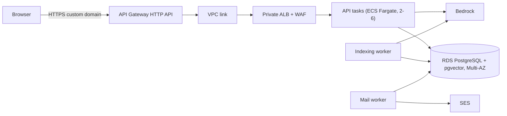

# AWS deployment design

`infra/main.tf` describes how Nexus RAG would run on AWS. **It has not been applied.** The live demo runs on Floot, and my AWS deployments are [FraudGuard](https://github.com/naveenvarma999/fraudguard) and [Threadline](https://github.com/naveenvarma999/threadline). This document explains the design and the steps to deploy it.

## Architecture

| Layer | Resources | Why |
|---|---|---|
| Edge | API Gateway HTTP API on a custom domain; default `execute-api` endpoint disabled | One public entry point with TLS and throttling (50 req/s, burst 100) |
| Network | VPC link → **private** ALB with WAF; tasks accept traffic only from the ALB | Nothing except the gateway can reach the app; WAF adds per-IP limits and managed rules on auth paths |
| Compute | ECS Fargate: API service (2–6 tasks, CPU autoscaling) plus separate indexing and mail worker services | API latency is isolated from slow embedding and email work |
| Data | RDS PostgreSQL Multi-AZ with pgvector, encrypted storage, 14-day backups, deletion protection, verified TLS | One datastore for relational data, vectors, job queues and rate limits |
| Secrets & IAM | Secrets Manager for auth secret, JWT keys, Google secret and three separate DB credentials; task roles scoped to Bedrock models and SES identity | No static AWS keys; each service gets only what it needs |
| Observability | CloudWatch log groups, alarms for unhealthy targets and low DB storage; `X-Request-ID` on every response | Correlate a user's failed request with its logs |

The containers run as a non-root user (UID 10001) with a read-only root filesystem. Request logs record route, status and latency only, never cookies, codes, passwords or document text.

## Prerequisites (not created by Terraform)

- A VPC with two private subnets in different availability zones and outbound access to AWS services and Google
- A Route 53 hosted zone and an ACM certificate for the app domain
- An ECR repository for the image
- Bedrock access to Titan Text Embeddings v2 and a Converse chat model in the region
- An SES verified sending domain (with production access) and a Google OAuth web client

## Deployment steps

1. **Secrets:** create Secrets Manager entries for the auth secret, the JWT key map, the Google client secret and the three database users (`nexus_app`, `nexus_indexer`, `nexus_mail`), each with random values.
2. **Image:** build for `linux/amd64`, push to ECR and reference it by digest (`repo@sha256:…`) so deployments are immutable.
3. **Infrastructure:** copy `terraform.tfvars.example` to `terraform.tfvars`, fill in the values with `api_count = 0` and `worker_count = 0`, then `terraform init`, `validate`, `plan` and `apply`. Use a remote, encrypted, locked state backend; never commit tfvars or state.
4. **Migrate:** run the migration task once in the private subnets and check that it exits with code 0. It enables pgvector, creates the tables and HNSW index, installs the row-level security policies and grants each database role its permissions.
5. **Start:** set `api_count = 2` and `worker_count = 1` and apply again.
6. **Schedule cleanup:** run `python -m app.cleanup` daily (for example EventBridge Scheduler) with the API task definition.

## Staging checks before real users

- Sign-up email arrives via SES; wrong-password lockout and password reset behave as designed
- Signing out makes a copied access token useless
- A second account cannot list, delete or retrieve the first account's documents or history
- An upload moves pending → ready, and answers cite the right excerpts
- Killing an indexing worker mid-job leads to lease takeover and exactly one set of chunks
- A simulated Bedrock outage opens the circuit breaker and it recovers afterwards
- Load test the admission limits (`scripts/load_test.py`) and measure latency, DB connections and Bedrock cost
- Exercise a database failover and a backup restore

## Cost note

Multi-AZ RDS, an ALB, NAT egress and always-on Fargate tasks cost money even when idle. For a portfolio demo, a single EC2 instance running `docker compose` (as in my other projects) is far cheaper; this design targets a production-shaped deployment.
