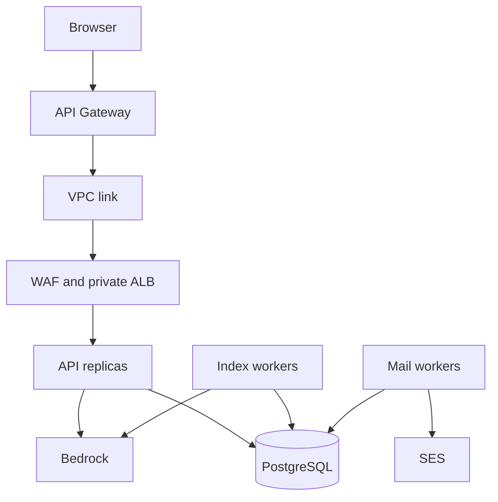
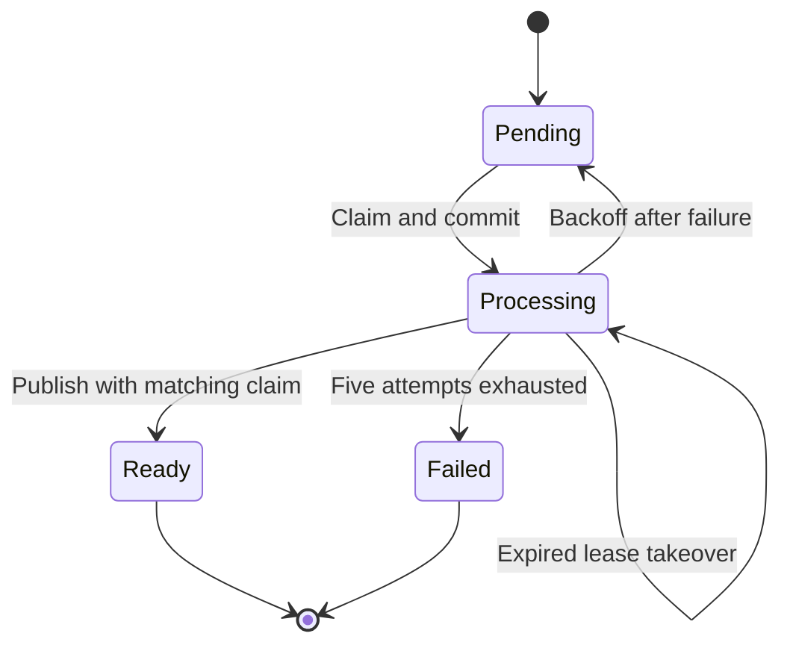

# Version 2 system design

## Public request and trust boundaries

The public custom domain terminates TLS at API Gateway. Its default execute-api endpoint is disabled. The ALB accepts traffic only from the VPC-link security group, and API tasks accept traffic only from the ALB. WAF attaches to the ALB: a source-IP budget uses a header overwritten by API Gateway, and managed common rules apply to authentication paths. WAF request sampling is disabled to avoid capturing credentials. The managed rule scope deliberately excludes document ingestion, where arbitrary source text is expected. WAF is an extra filter, not a replacement for application validation. Validate rule false positives in staging.

The application validates cookie JWTs and checks database session state on each protected request. The gateway is not configured as a cookie JWT authorizer. Source-IP headers are trusted only when `TRUST_GATEWAY=true` behind the restricted private ingress path. Local development trusts the socket peer. VPC-link/ALB/container hops use HTTP; add internal TLS if your policy requires it. RDS connections use certificate-verified TLS.

## Authentication and sessions

Passwords use Argon2id (19 MiB, two iterations, one lane), never recoverable encryption. Successful logins rehash when configured parameters change. Signup and recovery codes are cryptographically random six-digit values, expire after ten minutes, are HMAC protected in storage and consumed once inside the account transaction. Five incorrect passwords lock password verification for one hour; five incorrect OTPs lock that email/purpose for one hour, including across resends. Valid password recovery clears the password lock and revokes all sessions. Google sign-in is independent of the local password lock.

Access JWTs last 15 minutes and include `kid`, issuer, audience, subject, session ID, token ID, issuance time and expiration. Only configured HS256 keys are accepted. Production signing keys are separate from the digest/outbox encryption secret. Refresh tokens are random opaque values stored as HMAC digests; every refresh rotates the token. Replay revokes its whole session family. Logout revokes the session and blacklists associated access-token records, so merely copying a JWT does not bypass logout.

Sessions have a 30-day absolute lifetime, a 30-minute **request inactivity** limit and a cap of five active sessions. An authenticated background poll counts as activity; this is not a keyboard/mouse inactivity detector. On new login, the oldest session is revoked when necessary. Session list, per-session revocation and sign out everywhere are exposed in the Account security screen. Authenticated password changes require the current password and revoke all sessions. The browser serializes refreshes with Web Locks when available; strict replay protection can require sign-in after a lost refresh response or a concurrent refresh on older browsers.

Google uses authorization code exchange, state, nonce and PKCE. The backend verifies the ID-token signature, algorithm, issuer, audience, authorized party when present, expiry, nonce and verified email. Accounts are identified by Google's `sub`. Existing local accounts are not automatically linked by email. Authenticated linking and MFA are not offered in this release. Verification email alone is not login MFA.

Browser mutations require the exact configured Origin. Authenticated mutations additionally require a session-bound CSRF token. Cookies are HttpOnly where appropriate, Secure under HTTPS, and SameSite=Lax. Strict CSP, frame denial, content-type protections and permissions restrictions apply. User-supplied text, including browser user agents and AI answers, is escaped before rendering.

## Database isolation and permissions

Every content operation still includes the authenticated user ID in its SQL filters. On PostgreSQL, `documents`, `chunks` and `search_history` additionally use ENABLE/FORCE ROW LEVEL SECURITY. `user_transaction` sets `app.user_id` using `set_config(..., true)`, making the identity local to that transaction; a reused pool connection does not inherit the last user's identity. Missing context returns no protected rows and disallows writes for ordinary roles.

The API DB role has DML permissions but cannot own/alter tables or bypass RLS. The index-worker DB role can access only documents, chunks and circuit state; a named policy allows that role to index across users. It cannot read authentication tables. The mail-worker DB role can access only the outbox. The migration task alone receives the database administrator credential. These are separate DB credentials in AWS, while local Compose uses its development superuser. PostgreSQL tests explicitly switch to non-superuser roles to verify policy behavior.

RLS is defense against forgotten filters, not a shield against total API compromise: the API controls the transaction identity. Administrative database roles and superusers remain privileged. Organization membership, sharing roles and tenant administration are not present; isolation here is per account.

## Admission control and outages

Application rate limits now use shared PostgreSQL token buckets: a locked row holds tokens and update time; elapsed database time refills tokens continuously to a maximum capacity. A request consumes one token or receives 429 with Retry-After. Application-host clock differences do not affect production refill calculation. This avoids fixed-window boundary resets, but still permits the configured initial burst. PostgreSQL write throughput and contention must be measured; this is a deliberate baseline instead of adding another critical datastore without evidence it is needed.

| Budget | Capacity and refill |
|---|---|
| API Gateway | 50 requests/sec, burst 100; AWS best-effort throttle |
| WAF source IP | 1,000 requests per default five-minute evaluation window |
| API source IP | Burst 300, refill 300/minute |
| Login per email | Burst 30, refill 30/hour, plus five-failure lock |
| Signup/reset emails | Burst 3 per email/purpose, refill 3/hour; one/minute cooldown |
| Global signup/reset mail | Burst 100, refill 100/hour |
| OTP verification | Burst 20 per email/purpose, refill 20/hour, plus five-failure lock |
| RAG/ingestion admission | Burst 20/user and 100/global, refilled each minute |
| Foreground work | Two leases/user and twelve/global |

A token bucket is not an exact rolling-hour maximum; e.g. it allows a capacity burst followed by continuous refill. Use measured abuse/traffic requirements to tune policy. Account lockout can be deliberately triggered by someone who knows an email address; that is a tradeoff in the requested strict five-attempt policy.

Provider circuit state is shared by all replicas. Five recorded AWS failures open the circuit for 30 seconds. The next caller claims one 45-second recovery probe; other callers fail fast. A generation counter prevents old in-flight outcomes from closing a newly opened circuit. Success closes it; AWS failure reopens it. Embedded SDK calls have bounded connection/read timeouts and automatic SDK retries disabled. Unexpected response parsing failures do not count as AWS transport/service failures; a claimed probe expires if a caller dies.

Foreground admission leases expire after 15 minutes to recover from process crashes. Background work is bounded separately by worker replica count. DB connections have a three-second connect deadline, two-second lock timeout and five-second statement timeout; pool wait is ten seconds. Those limits contain individual operations, not a hard end-to-end request deadline. Gateway requests may still time out during combined contention/provider delays. Chat is synchronous and non-streaming; check saved history before manually retrying an ambiguous timeout.

## Worker delivery and recovery

Index workers claim a due document with SKIP LOCKED, commit, then call Bedrock outside a database transaction. A heartbeat extends the five-minute lease before each chunk. Every claim receives a new token. Final publication locks and checks that token, so a worker whose lease was taken over cannot publish duplicate/stale chunks. All chunks publish atomically. Errors retry with exponential delay and jitter up to five attempts; exhaustion marks the document failed and removes the pending raw content. Deleting and uploading again is the user-facing retry action. Monitor pending age, attempts and failed counts; there is no dedicated dead-letter queue service or redrive dashboard.

The mail worker uses the same claim/execute/commit pattern with a 60-second lease and five-attempt bound. Expired messages never send. Payloads are encrypted and cleared after acceptance, expiry or final failure. Claim fencing prevents stale database updates, but cannot unsend a message: a crash after SES accepts and before commit may send the same code twice. Delivery is at-least-once. SES acceptance is not final delivery; configure delivery/bounce/complaint events and operational alerts in your account.

## Retrieval and data lifecycle

Documents are text/Markdown, limited to 20,000 characters and 100 documents/account. Overlapping chunks are embedded with Titan V2 into 1,024-dimensional vectors. A query retrieves five authorized chunks by cosine distance from pgvector and asks a Converse model for a grounded answer with numbered source excerpts. Document hashes deduplicate ingestion per user. No untrusted document instruction receives executable tools. Answers are rendered as text. This does not guarantee factual accuracy or immunity to prompt injection.

HNSW accelerates search. Filtered approximate retrieval can reduce recall; evaluate your corpus before tuning iterative scans or partitioning. This is semantic retrieval, not a hybrid reranking pipeline. Saved source excerpts remain in history when the source document is removed; users can clear history. Define retention/account-erasure requirements before launch.

## Operations and remaining validation

Request metadata logs include a generated request ID, route template, response status and elapsed time, without query strings, cookies, credentials or document content. The same ID is returned in `X-Request-ID`. This supports correlation, not full distributed tracing. CloudWatch handles logs, gateway metrics and task metrics; alarms include unhealthy API targets and low database storage. Incident notification and queue dashboards still need account setup.

Run daily cleanup for expired auth records, token buckets, processed mail records, stale admission leases and audit events older than 90 days. Schedule it with the API role, not the migration administrator. Auth gate rows remain persistent. Multi-AZ RDS, two API replicas, autoscaling, private networking and deployment rollback improve availability; they do not guarantee an SLO. RPO/RTO are not established until backup/failover exercises run. Versioned upgrade instructions and key rotation are in UPGRADE-V2.md.

## Primary references

- OWASP session management: https://cheatsheetseries.owasp.org/cheatsheets/Session_Management_Cheat_Sheet.html
- OWASP authentication: https://cheatsheetseries.owasp.org/cheatsheets/Authentication_Cheat_Sheet.html
- OWASP password storage: https://cheatsheetseries.owasp.org/cheatsheets/Password_Storage_Cheat_Sheet.html
- OWASP recovery: https://cheatsheetseries.owasp.org/cheatsheets/Forgot_Password_Cheat_Sheet.html
- PostgreSQL row security: https://www.postgresql.org/docs/17/ddl-rowsecurity.html
- Google OpenID Connect: https://developers.google.com/identity/openid-connect/openid-connect
- AWS HTTP API private integrations: https://docs.aws.amazon.com/apigateway/latest/developerguide/http-api-develop-integrations-private.html
- AWS HTTP API quotas: https://docs.aws.amazon.com/apigateway/latest/developerguide/http-api-quotas.html
